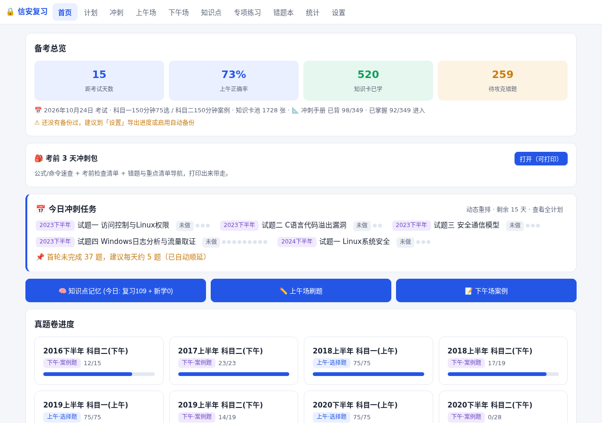
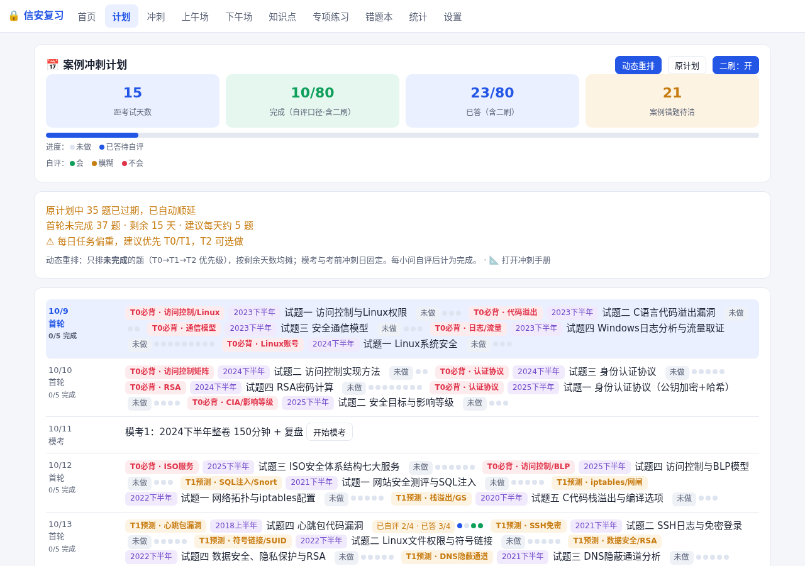
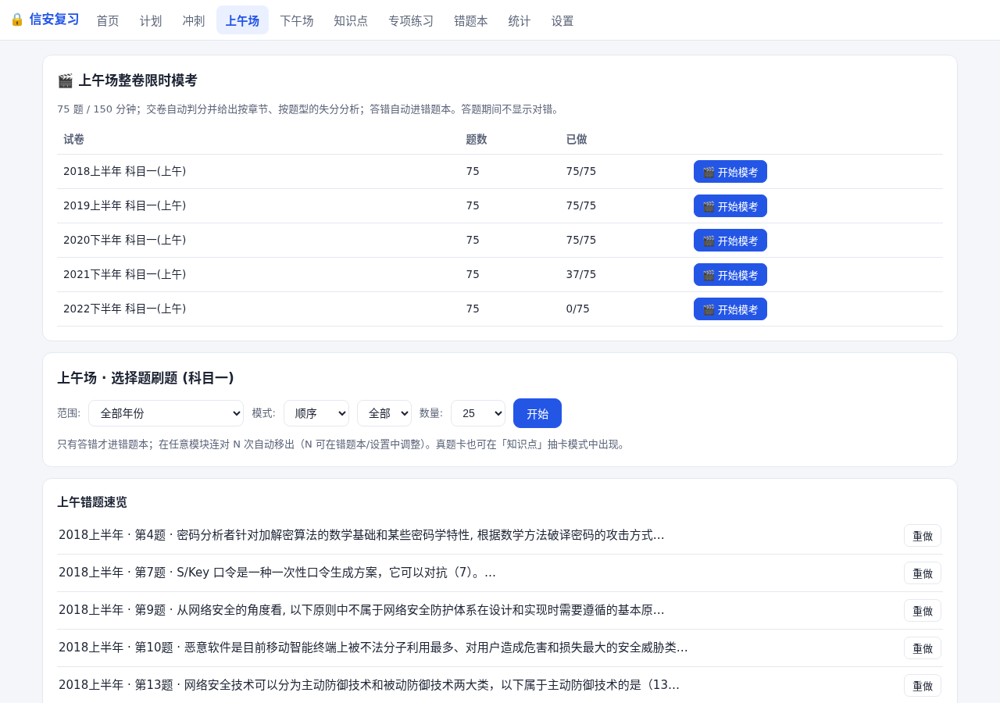
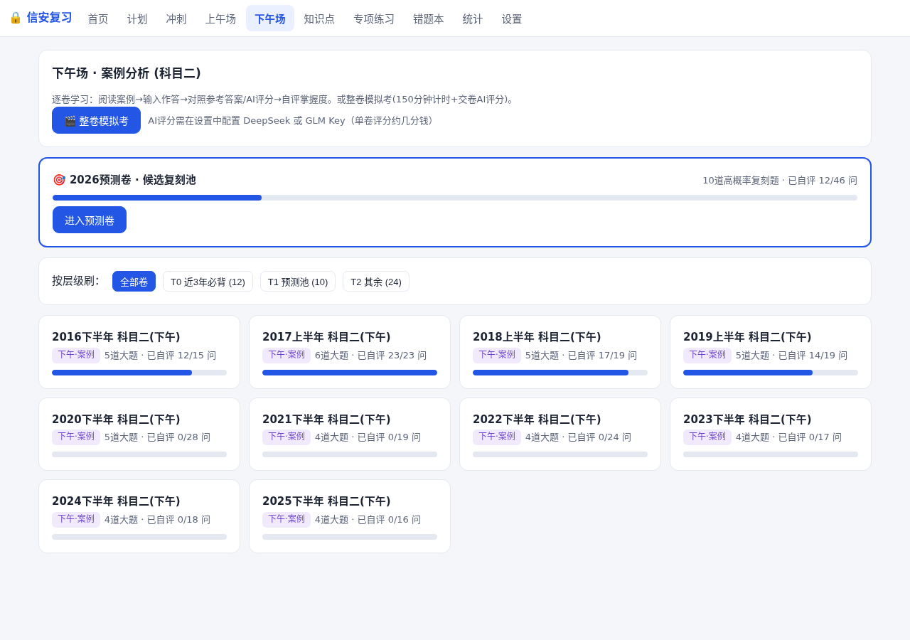
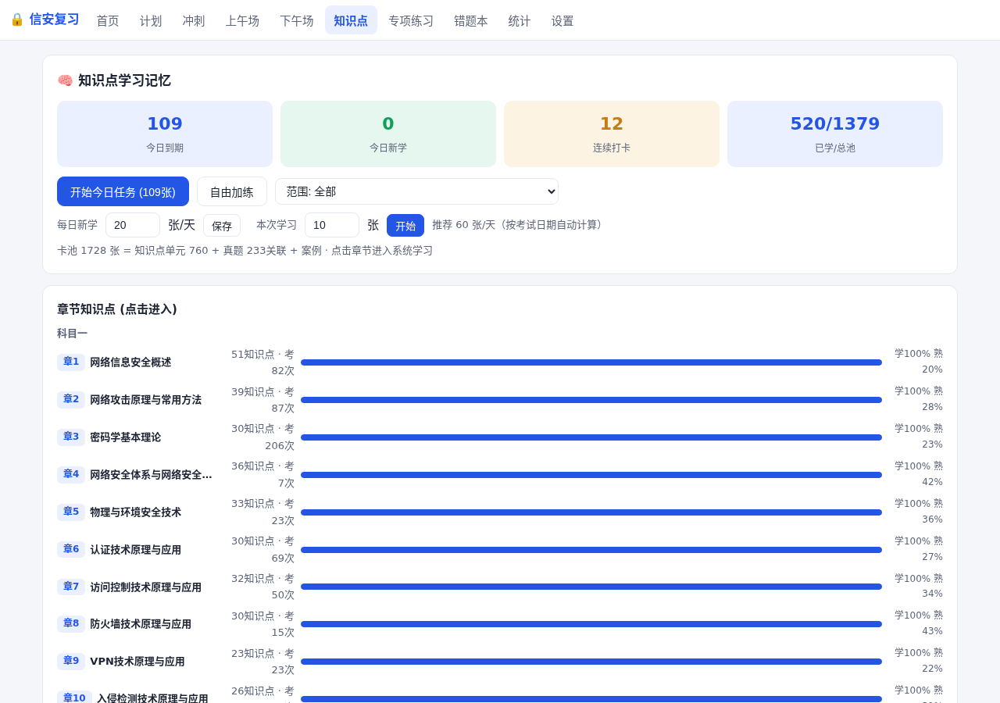
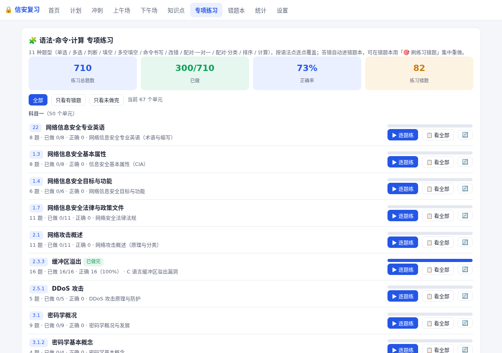
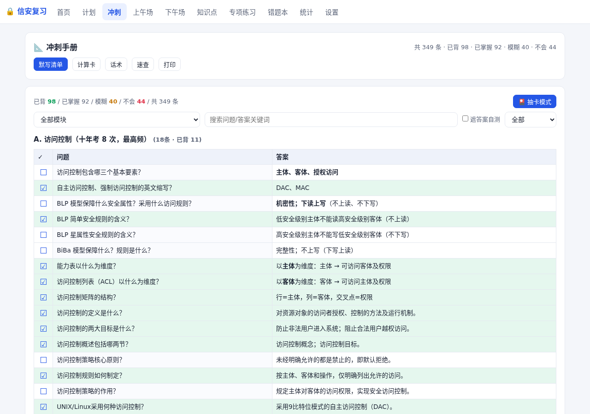
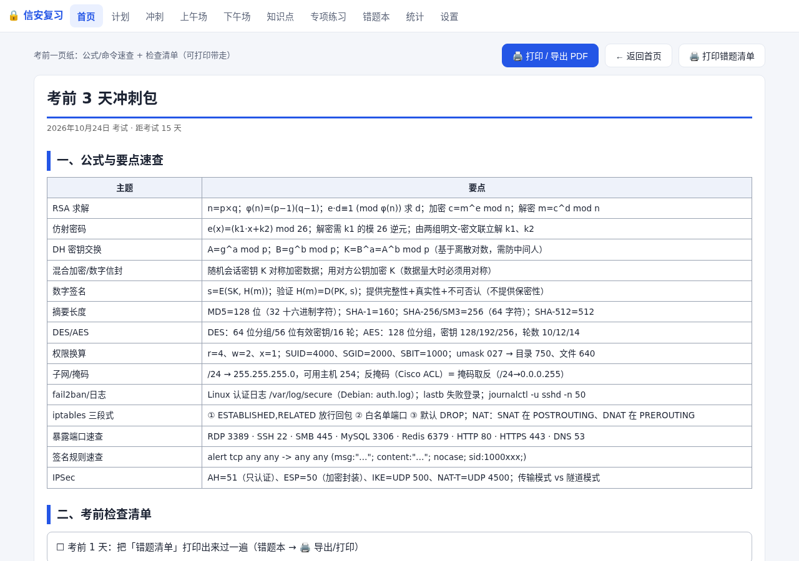

# 信息安全工程师复习系统 v3.0

[](CHANGELOG.md)
[](LICENSE)
[](#快速开始)
[](#)

面向 **2026 年下半年软考中级·信息安全工程师**（考试日期 2026-10-24 ~ 10-27）的本地复习工具。

纯前端单页应用，无需安装、无需服务器：**双击 `复习系统.html` 即可使用**（推荐 Edge / Chrome）。

数据规模：**375 道选择题 · 46 道案例（198 小问）· 760 个知识单元 · 710 道专项练习 · 349 条冲刺手册 · 26 章教材全文 + 347 张插图**。

---

## 界面预览

| 首页 · 备考总览 | 计划 · 动态重排 |
|---|---|
|  |  |

| 上午场 · 整卷限时模考 | 下午场 · 案例分析 |
|---|---|
|  |  |

| 知识点 · 抽卡记忆 | 专项练习 · 语法命令计算 |
|---|---|
|  |  |

| 冲刺手册 · 默写清单 | 考前 3 天冲刺包 · 可打印 |
|---|---|
|  |  |

---

## 快速开始

1. 下载本仓库（`Code → Download ZIP`）或 `git clone`
2. 双击打开 `复习系统.html`
3. 首次使用建议在「设置」页确认考试日期、按需填入 AI Key
4. 学习进度保存在浏览器 localStorage 中（换浏览器/清缓存不通用），请定期备份（见下文）

## 功能总览

| 模块 | 说明 |
|---|---|
| 首页 | 倒计时、今日任务（同步动态重排）、总体进度、逾期提醒 |
| 计划 | **动态重排**（默认）/ **原计划** 双视图：只排未完成题（T0→T1→T2），按剩余天数均摊；锚点跟随考试日期；二刷可开关；小问级进度 + 状态圆点 |
| 冲刺手册 | 清单 300 条 / 计算卡 16 / 话术 49 / 速查 24，可勾选记录、支持打印 |
| 上午场 | 375 道选择题（2016-2025），做题 / 背题双模式；组题自动显示共享材料；**🎬 整卷限时模考（75 题/150 分钟 · 题卡 · 自动判分 · 失分分析）** |
| 下午场 | 46 道案例（198 小问），AI 批卷 + 详细讲解 + 关联知识点；题干自动排版；每题保存状态 |
| 知识点 | 760 个知识单元，抽卡背诵、单元做题、教材全文（26 章）、315 张插图、**⑤ 语法·命令·计算 专项练习** |
| **专项练习** | **710 题 / 11 种题型 / 67 个单元**（见下文）：顶部导航独立页 + 知识点首页专区 + 章节页按钮 + 单元页顶部快捷按钮，支持逐题模式与筛选；**465 题带「📝 分步详解」** |
| 错题本 | 只有做错过的题才会进入；连对 N 次自动移出；**支持刷选择题 / 案例题 / 手册题 / 练习错题**，数量可自定义；**🖨 错题清单导出（Markdown / 打印）**；**⭐ 重点题收藏与清单一键刷** |
| 统计 | 正确率、每日打卡、**薄弱章节榜（选择+练习双口径）**、**练习正确率**、模拟考成绩 |
| 考前冲刺包 | 首页入口：公式/命令速查 + 考前检查清单 + 错题与重点导航（A4 可打印） |
| 设置 | AI Key、考试日期、页面宽度、备份 / 导入 / 快照回滚、版本号 |

## 单题重做与批量重做（v3.0）

- **单题重做**：专项练习每题判分后、选择题（上午场/刷错题/真题卡/单元页③）均有 🔄 重做本题 —— 清空该题作答回到未答态，**连对与错题本状态保留**
- **多选题**：选项选中即时高亮（蓝框+✓）、显示「已选 n 项」、未选时提交按钮置灰
- **返回上下文**：从专项练习/错题本/重点清单/统计页进入单元或章节时，页面「返回」会回到来源模块（如「返回专项练习」），不再一律回知识点
- **批量重做**：单元页 ⑤ 头部与逐题模式顶部提供 🔄 批量重做，三档范围 全部 n / 仅错题 m / 仅未做 k，可选「重置并开始逐题练」或「仅重置全部」

## ⑤ 语法·命令·计算 专项练习（v2.0 新增，v2.1 增加入口体系）

在**知识点单元页**底部有「⑤ 语法·命令·计算 专项练习」区块，另有 **4 个专用入口**（v2.1）：

| 入口 | 位置 | 说明 |
|---|---|---|
| 🧩 **专项练习**（顶部导航） | 与 知识点/错题本 并列 | 汇总卡 + 筛选（全部·只看有错题·只看未做完）+ 按科目分组列 19 个单元，每行 `▶ 逐题练` / `📋 看全部` |
| 🧩 **专项练习**（知识点首页） | 🧠 知识点学习记忆 页 | 同一个专区列表，可直接开练 |
| 🧩 **练习(n)**（章节列表页） | 点章进入后的单元列表 | 该单元有练习时显示，直达逐题模式 |
| 🧩 **去练习(n)**（单元页顶部） | 单元页标题栏 | 一键滚动定位到底部 ⑤ 区块 |

**逐题模式**：一次一题（题干 + 作答 + 立即判分 + 参考答案 + 解析），带 `上一题` / `跳过·下一题` / `退出`，单元入口退出后回到该单元页；错题本入口退出后回到错题本。

**11 种题型**

| 题型 | 代码 | 判分方式 |
|---|---|---|
| 单选 | choice | 选项精确匹配 |
| 多选 | multi | 集合相等（多选/少选均判错） |
| 判断 | judge | 对/错 |
| 填空 | fill | 归一化比较 + 别名/纯数值容错 |
| 多空填空 | blanks | 逐空比较（全对才判对） |
| 命令书写 | cmd | 显示参考答案 + 🤖 AI评分 / 自评 |
| 改错 | fix | 显示参考答案 + 🤖 AI评分 / 自评 |
| 配对（一对一） | pair | 每行逐一比对 |
| 配对（分类） | group | 每行归类逐一比对 |
| 排序 | order | 序列完全一致（↑↓ 调整） |
| 计算 | calc | 逐空比较（数值容错） |

**📝 分步详解（v2.2 新增）**：191 道题在判分后额外展示「📝 详解」——
- 计算类：公式 → 代入数值 → 逐步取模/化简 → 回代校验 → 结论
- 命令 / 改错类：逐段拆解（表·链·动作/每个参数含义/完整命令）+ ⚠ 常见错误
- 概念类：要点拆解 + 判断依据 + 易错点
- 逐题模式默认展开；单元页平铺模式折叠显示（点开查看）

**覆盖范围（710 题 / 67 单元，v2.9）**

| 单元 | 主题 | 题数 |
|---|---|---|
| `G2-3.1` | iptables 防火墙规则与命令 | 50 |
| `G2-3.2` | Wireshark 显示过滤 / Snort 规则语法 | 52 |
| `G2-4.1` | Windows 事件ID / Linux 日志与命令 / Linux 权限换算 | 85 |
| `3.1` `3.1.2` `3.1.3` `3.2` `3.2.1` `3.2.2` `3.2.3` | 密码学概况 / 基本概念 / 安全性分析 / 体制分类 / 私钥·公钥·混合体制 | 28 |
| `3.3` `3.3.1` `3.3.2` `3.3.3` `3.3.4` `3.3.5` | 常见算法 / DES / IDEA / AES / RSA / 国产密码 | 52 |
| `3.4` `3.4.1` `3.4.2` `3.4.3` | Hash 与签名总览 / Hash 函数 / Hash 算法 / 数字签名 | 30 |
| `3.5.1` `3.5.2` `3.6.1` `3.6.2` `3.7.1` `3.7.3` `3.7.4` | 密码管理 / 数字证书·PKI / DH / SSH / 应用场景 | 30 |
| `U7.1` `U7.2` `U7.3` | 访问控制概述 / 模型(DAC·MAC·RBAC·BLP·Biba) / 实现 | 6+10+6 |
| `U2.3.3` | C 语言缓冲区溢出 | 16 |
| `U6.2` `U6.3` | 身份认证与 PKI / 认证协议(RADIUS·802.1x·TLS) | 8+8 |
| `U22.4` | Web 应用安全（注入/XSS/CSRF/上传） | 16 |
| `U4.4.5` `U1.7` `U25.2` `U1.3` `U12.1` | 标准 / 法律法规 / 移动安全 / 安全属性 / 安全审计 | 10+11+8+8+8 |

**来源标注（不虚构）**：每题都带来源标签——
- `来源：YYYY上下半年案例试题N 问题M`（真题/案例改编）
- `来源：教材X.X节`
- `来源：官方语法（自编练习）`（依据官方命令/规则/协议语法编写）

**覆盖矩阵报告**：`资料/drills_coverage.md`（单元→题号→考点→来源，含判分口径）
（注：`资料/` 目录为源资料归档，不随发布包分发）

## 错题本刷题说明

顶部设置：**数量 / 顺序 / 掌握连对次数**（四个刷题入口共用）
- **数量**：下拉可选 `10 / 20 / 50 / 全部`，或选 **自定义…** 输入 1–999 任意数量

四个刷题按钮（各显示可用题数）：
| 按钮 | 刷题方式 |
|---|---|
| 🎯 刷选择题错题 | 上午场做题界面（选项作答）；答完后可点「📚 关联知识点」去复习该题知识点 |
| 🎯 刷案例错题 | 错题本内专用页：案例背景 + 本题图表 + **空白作答框（🔄 重做模式）** + AI评分 + 显示答案/解析 + 😀会/😐模糊/😰不会 |
| 🃏 刷手册错题 | 抽卡手册卡：翻面看答案 → 忘记/模糊/记得 |
| 🎯 **刷练习错题**（v2.0） | 专项练习错题逐题重做（单选/多选/判断/填空/多空/命令/改错/配对/归类/排序/计算） |

- 顺序：随机 / 顺序（案例题按年份、案例、题号）
- 掌握：连对 N 次（默认 2）或点「已掌握」即移出错题本
- 案例错题列表的「查看」会自动滚动到该小题；练习错题的「重做」会跳到所属单元并滚动到该题

## 案例错题重做说明（v1.9）

- **答题框默认清空**（`🔄 重做模式`）
- **上次记录默认隐藏**（不剧透）：收进折叠区 `📄 上次记录（已自评 · AI已评 · 旧草稿）`；`↩ 恢复上次作答` 一键回填
- **每题都有知识点入口**：`📚 本题知识点：` 列出该小题全部关联单元；单元页顶部 `← 返回案例错题重做`

## 计划页说明

**动态重排（默认）**
- 只排**未完成**的题，按原计划顺序（T0 必背 → T1 预测 → T2 旧题）从今天起按剩余天数均摊
- 锚点日固定（相对考试日自动计算）：模考1（-13 天）、模考2（-6 天）、默写/二刷（-5 ~ -4 天）、模考3（-3 天）、冲刺（-2 ~ -1 天）、考试周（考试日起 4 天）
- 顶部提示：逾期题数（已自动顺延）、剩余未完成数、建议每日题量
- **二刷开关**：开启时首轮完成后安排二刷；关闭时优先保证全覆盖 46 题

**原计划**：固定 37 天理想日历（9/17-10/23），可随时切回查看。

**完成口径**：每个小问自评（😀会 / 😐模糊 / 😰不会）后计为完成；只作答未自评显示为"待自评"。
**图例（两行）**：进度 `○未做 · ◐已答待自评`；自评 `●会（绿）· ●模糊（黄）· ●不会（红）`

## 进度记录说明

以下操作都会计入进度（同步到计划页与错题本）：
- 案例页 / 知识点单元页（**做题模式**）：输入作答、AI 评分、点"会/模糊/不会"
- 知识点抽卡 / 刷案例错题：同上
- 知识点抽卡 / 刷手册错题里的案例卡与手册卡：按卡面按钮评分
- **专项练习（⑤ 区块）**：单选/多选/判断/填空/多空/配对/归类/排序（提交后即记录）、命令书写与改错（AI评分或自评后记录）

以下操作**不**计入进度：背题模式（直接看答案）、点"显示答案/解析"仅浏览、仅渲染浏览练习而不作答。

## 版本确认（排查浏览器缓存）

- 「设置」页顶部显示：`版本: v3.0 · 数据: 题库 v2 / 知识卡 v3 / 手册 v2`
- 控制台（F12）启动时输出：`信息安全工程师复习系统 v3.0`
- 若版本不对，请按 **Ctrl+F5** 强制刷新

## AI 配置

- 本发布包已**清空** `data/keys.js` 中的 Key（防止泄露）
- 两种配置方式（任选其一）：
  1. 在「设置」页填入 API Key（推荐，仅存本机浏览器）
  2. 编辑 `data/keys.js`，在 `glmKey` 中填入 Key
- 默认服务商：智谱 GLM（模型 `glm-4.7-flash`），兼容 OpenAI 格式接口

## 数据备份

- **自动备份**：设置页可授权一个本地文件夹，每日自动写入进度备份文件
- **手动导出 / 导入**：设置页一键完成（注意：导出文件含设置中的 API Key，勿外发）
- **快照回滚**：重要操作前自动存快照，可在设置页恢复

## 目录结构

```
复习系统.html          主应用（单页）
案例冲刺手册.html      独立打印版手册
README.md             本文件
CHANGELOG.md          完整版本演进记录（v1.0 → v3.0）
VERSION.txt           版本与数据规模说明
LICENSE               MIT License
docs/images/          界面配图
data/
  questions.js         题库（375 选择 + 46 案例/198 问，15 套卷）
  cards.js             知识单元（760）
  drills.js            专项练习（710 题 / 11 题型 / 67 单元）
  ai_content.js        知识点 AI 讲解
  handbook.js          冲刺手册数据
  explain.js           案例详细讲解（46）
  plan.js              冲刺计划
  figs.js / syllabus.js / keys.js / import_template.json
  textbook/            教材全文（26 章）
assets/
  img/                 案例题图片（32）
  textbook/            教材插图（315）
scripts/               数据构建 / 修复 / 审计脚本（开发维护用）
```

## 版权声明

- **代码部分**（HTML / JS / CSS / Python 脚本）以 [MIT License](LICENSE) 开源，欢迎学习参考。
- **题库中的历年真题文本**版权归**中国计算机技术职业资格网 / 全国软考办**所有；**教材正文与插图**版权归**《信息安全工程师教程（第 2 版）》原作者及出版社**所有。
- 上述内容在仓库中仅作**个人学习备考**用途，请勿用于任何商业用途或二次分发。
- 若权利人认为本仓库内容侵犯其权益，请联系删除。

## 致谢

- 题库与教材内容整理自 2016-2025 年软考真题及《信息安全工程师教程（第 2 版）》
- 版本演进与逐版更新记录见 [CHANGELOG.md](CHANGELOG.md)
